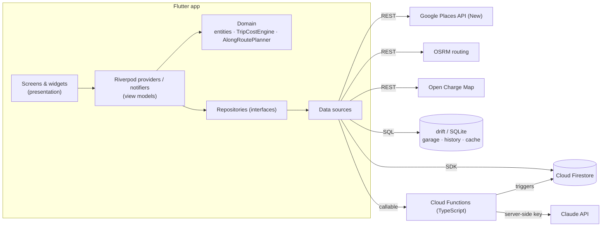

# FuelWise

[](https://github.com/ZubayeerAlam/gas-Station-Finder-/actions/workflows/ci.yml)


-FFCA28?logo=firebase)

**Find the stop that is actually cheapest — not just the lowest number on the sign.**
FuelWise finds fuel stations and EV chargers, then ranks them by the *true trip cost*: what you pay at the pump **plus** the fuel or charge the detour itself burns, for *your* vehicle.

> Status: active development. Screenshots and GIFs will be added once the Google Maps key is live. See [PLAN.md](PLAN.md) for the checklist and [BUILD.md](BUILD.md) for the verified build log.

## Features

| Feature | What it does | Status |
|---|---|---|
| Nearby stations | Map of fuel stations around you, details sheet with hours, rating, Google fuel prices | Built · needs a working Google key for live data |
| True trip cost | Purchase cost + detour cost per vehicle; *Cheapest*, *Least detour*, *Best value* strategies with plain-language explanations | Built · unit-tested |
| My Garage | Cars and EVs with consumption, tank/battery size, unit conversion (mpg, km/L, mi/kWh…) | Built · simulator-tested |
| Stations along my route | Searches the whole route in segments, real driving detours (OSRM), ranking per stop | Built · needs Google key for live search |
| EV mode | Open Charge Map chargers, connector/power filters, kW markers, clustering | Built · needs a free OCM key |
| Fill-up history | Fill-ups and charging sessions, full-to-full consumption, monthly charts | Built · simulator-tested |
| Community prices | Crowdsourced reports with outlier rejection, trust scores, price history, reliability votes, price alerts | Built · Firebase **emulator**-tested |
| AI trip assistant | Chat with Claude; it plans with the app's own ranking engine and shows tappable station cards | Built · tested with a fake model; needs an Anthropic key |
| Offline | Saved station *positions* (place IDs + coordinates only, ≤ 30 days, per Google policy), local garage/history, Firestore offline cache | Built · unit-tested |
| Languages | English and বাংলা (Bengali); follows the device or a manual choice | Core screens translated; rest in progress |

**Honesty rules the code follows:** prices come only from Google or community reports, never estimated · "Best value" is labelled as a heuristic · stale data is marked, never shown as verified · the AI never invents a number — every figure comes from the app's own calculation.

## Architecture

Clean Architecture + MVVM, feature-first, Riverpod for state and dependency injection, go_router for navigation.



```
lib/
  core/        config, database (drift), error (AppFailure + Result), firebase, location,
               network (dio + retry), router, theme, utils, widgets
  features/
    stations/   along_route/   route/   ranking/   ev/
    garage/     history/       prices/  assistant/
      ├─ domain/        entities, pure logic, repository interfaces
      ├─ data/          API / database implementations, mappers
      └─ presentation/  screens, widgets, providers
  l10n/        app_en.arb, app_bn.arb (+ generated AppLocalizations)
functions/     Cloud Functions: price trust & aggregation, alerts, AI assistant
firestore.rules, firestore.indexes.json
```

## Getting started

Requirements: Flutter 3.47 (stable), Xcode (iOS) or Android SDK, Node 22 + Java 21 for the Firebase emulators.

```bash
git clone https://github.com/ZubayeerAlam/gas-Station-Finder-.git
cd gas-Station-Finder-
flutter pub get
cp config/example.json config/dev.json          # then fill in your own keys
cp ios/Flutter/Secrets.example.xcconfig ios/Flutter/Secrets.xcconfig
flutter run --dart-define-from-file=config/dev.json
```

Keys live only in gitignored files (`config/dev.json`, `ios/Flutter/Secrets.xcconfig`, `functions/.secret.local`). Restrict the Google key to the app's package/bundle ID (`com.fuelwise.app`) and to the APIs it needs (Maps SDK for Android/iOS, Places API (New)).

### Community prices and the AI assistant (no Firebase project needed)

```bash
cd functions && npm ci && npm run build && cd ..
# optional, real Claude in the emulator (never commit this file):
#   echo 'ANTHROPIC_API_KEY=<your key>' > functions/.secret.local
firebase emulators:start --only auth,firestore,functions --project demo-fuelwise
flutter run --dart-define-from-file=config/dev.json --dart-define=FIREBASE_MODE=emulator
```

Without an Anthropic key the emulator answers with a clearly labelled *offline demo* (not Claude).

## Tests

```bash
flutter analyze
flutter test --coverage
python3 tool/domain_coverage.py coverage/lcov.info 70   # domain-layer coverage gate
cd functions && npm test                                 # unit + rules + emulator tests
```

CI ([`.github/workflows/ci.yml`](.github/workflows/ci.yml)) runs all of the above plus a debug APK build on every push and pull request. CI never deploys anything.

## Privacy & data

- Anonymous Firebase sign-in only; no personal data is required.
- Google Places content is not stored except place IDs and coordinates (deleted after 30 days).
- Garage and history stay on the device.
- The Claude API key is a server-side secret; the app only sends your message and the results of on-device calculations.

## Author

Zubayeer Alam — [GitHub](https://github.com/ZubayeerAlam)
